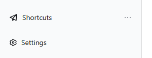
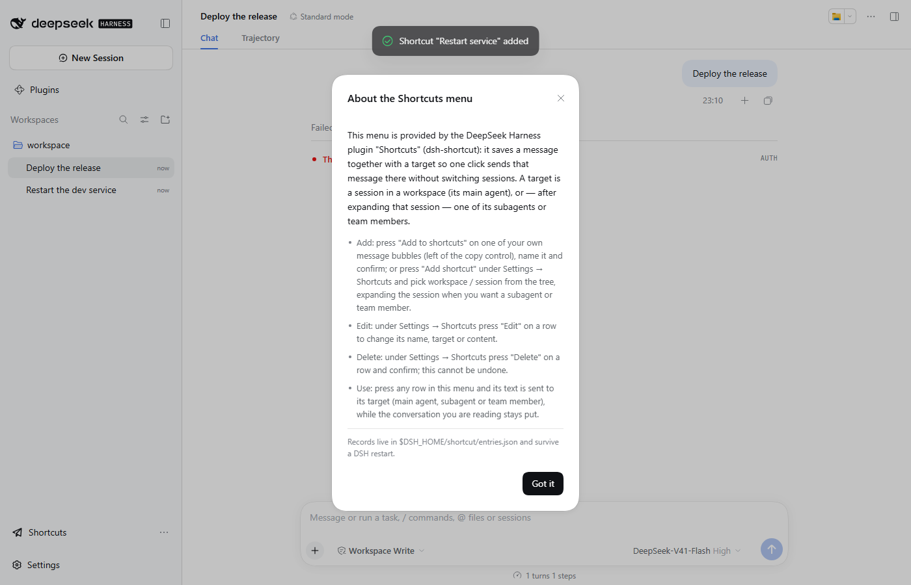
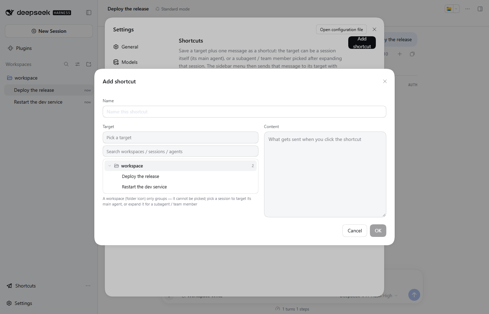
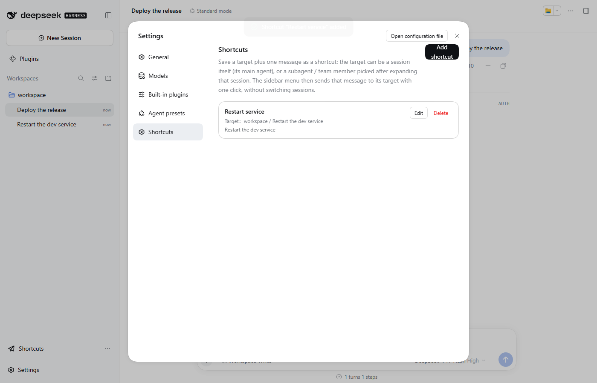

# dsh-shortcut

English | [中文](README.zh.md)

[](LICENSE)
[](package.json)
[](https://github.com/deepseek-ai/deepseek-harness)

A DeepSeek Harness (DSH) plugin that saves **a message** together with **its target agent**, then
delivers that message with one click — without switching conversations. The target is a leaf of the
workspace → session → agent tree: the session's own **main agent**, a continuable **subagent**, or an
**agent-team member**. It exists for the message you keep retyping in another session ("restart the
service"): capture it once, and it is one click away from anywhere.

| The sidebar-foot entry, directly above Settings | "Add to shortcuts" on a user bubble |
| --- | --- |
|  |  |

Opening the entry lists every saved shortcut; pressing one sends its text:


The menu's last item, **About this menu**, says which plugin provides it and how records are added,
edited and deleted:



## Features

- **Sidebar-foot menu, one click, no navigation**: a "Shortcuts" row sits between other plugins'
  footer actions and the shell's Settings row. It opens upward into a menu of every saved
  shortcut; pressing one delivers its text to the target while the page stays where it is. A
  toast names the target that received it.
- **The target tree lives in the dialog, not in a dropdown**: the add/edit dialog shows one
  read-only full-path line for the current target, followed by the tree itself (search, expandable
  workspaces/sessions, inline list). A workspace row wears the shell's own folder icon and is
  **grouping only** — it cannot be picked. Pressing a session row targets that session's
  **main agent** — there is no redundant "main agent" row. A session with subagents or
  agent-team members gets an expand arrow (only when they actually exist): expanding it lists its
  continuable **subagents** (labelled by the delegation's work description) and **team members**
  (by their member name). A subagent that has children of its own becomes a branch. Teams come
  from the session's own projection, so no experimental Team API is involved.
- **Capture from a message bubble**: every durable user message carries an "Add to shortcuts"
  button immediately **left of the copy control**. The dialog opens with the shortcut name empty
  and the content already filled with that bubble's text; the target is locked to that session's
  main agent (the bubble is what makes the shortcut point somewhere).
- **Manage in Settings**: `Settings → Shortcuts` lists every record with its target path — the
  `<workspace> / <session>` for a main-agent target, plus the leaf for a subagent or team member —
  edits name, target and content in the same dialog, deletes with a confirmation, and creates
  records by hand through the same tree picker. Reopening a saved shortcut selects its target,
  expands whatever is needed and **scrolls the selected row into view**.
- **Strict validation, readable failures**: the confirm button stays disabled until the name is
  non-blank and unused, a deliverable target leaf is chosen and the content is non-blank; the host
  re-checks the same rules. Delivery failures are classified and shown: target session missing,
  archived or busy, a **one-shot subagent that cannot receive messages**, an agent whose **parent
  session is not running**, an unreachable agent, or a generic send failure — never a silent no-op.
- **Durable and honest about it**: records live in `$DSH_HOME/shortcut/entries.json` (atomic write,
  survived restarts). The file is version 2 (target-aware); version 1 records are read as
  main-agent targets and rewritten on the next save. A corrupt store file is reported as an error
  rather than served as an empty list, so re-adding everything cannot overwrite a merely malformed
  file.

The capture dialog, seeded from the bubble:


The target picker: expand a workspace, then press a session (its main agent) — expand a session
with subagents / team members to target one of those instead:



The Settings page:



## Install

Once published to npm:

```sh
dsh plugin --profile web add dsh-shortcut
```

Or, if you run the harness through npx:

```sh
npx @deepseek-ai/dsh plugin --profile web add dsh-shortcut
```

From a checkout (what this repository supports today):

```sh
dsh plugin --profile web add /path/to/dsh-shortcut
```

Or mount it by hand in the profile's `cordis.patch.yml` and add the dependency yourself:

```yaml
- insert:
    - id: shortcut
      name: dsh-shortcut
```

Then restart `dsh web` (the host loads plugins once, at start-up) and refresh the page.

## Usage

1. In any session, hover your own message and press **Add to shortcuts**, give it a name, confirm.
2. Or add one by hand under `Settings → Shortcuts`: press **Add shortcut**, expand a workspace,
   then press a session to target its main agent (expand the session's arrow to target a subagent
   or team member).
3. Click **Shortcuts** at the sidebar foot and press that entry — the text is sent to its target,
   and the conversation you are reading does not change.
4. Rename, retarget, edit, delete or add records under `Settings → Shortcuts`.

## Notes

- **Compatibility**: built and tested against `@deepseek-ai/dsh` **0.2.0-rc.2**. The sidebar seat
  is `sidebar.footer.action`, the Settings page is `settings.section`, and the tree's data comes
  from the shell's own `workspaces`/`sessions` stores (a session's children are requested with
  `sessions.refreshProjections` on first expansion, because DSH does not persist that projection).
- **Two delivery paths, because DSH has two addressable agent families**:
  - a session's **main agent** goes through the host Session Controller
    (`ctx.sessionController.prompt`, `mode: 'queue'`), which resumes a cold session and persists
    the message;
  - a **subagent** or **agent-team member** is a continuable direct child of its parent session and
    goes through the host subagent runtime (`ctx.subagents.prompt`,
    `{ mode: 'continuable', delivery: 'queue' }`). A one-shot child cannot be addressed
    (`subagent/not-resumable`), and a child needs its direct parent session live
    (`subagent/parent-unavailable`); both are surfaced as readable errors, and the picker already
    greys out one-shot leaves so they cannot be saved in the first place.
- **The bubble button is a DOM bridge**: in 0.2.0-rc.2 a user message's action row has no plugin
  slot, so the button is injected next to the copy control using the chat view's semantic
  anchors (`data-chat-flow-kind`, `data-clock`, `data-chat-node-key`). It is idempotent,
  re-inserts itself after React re-renders, skips optimistic echoes, and is removed on unload.
  A future DSH that changes those anchors needs `src/client/bubble-capture.ts` updated.
- **Footer coexistence**: footer-action roots are `display: contents`; this plugin stacks them
  vertically (the same rule `dsh-diff-approval` uses) and defers to `dsh-footer-order` when that
  plugin is installed.
- **Scope**: existing sessions/agents only; no hotkey, no variables/placeholders, no scheduling,
  no cross-device sync. Records are shared across profiles under `$DSH_HOME`.

## Development

Development setup, the two halves, test/E2E commands and the pitfalls paid for: [DEVELOP.md](DEVELOP.md).
Publishing steps: [PUBLISH.md](PUBLISH.md). Changes: [CHANGELOG.md](CHANGELOG.md).

## License

MIT — see [LICENSE](LICENSE).
