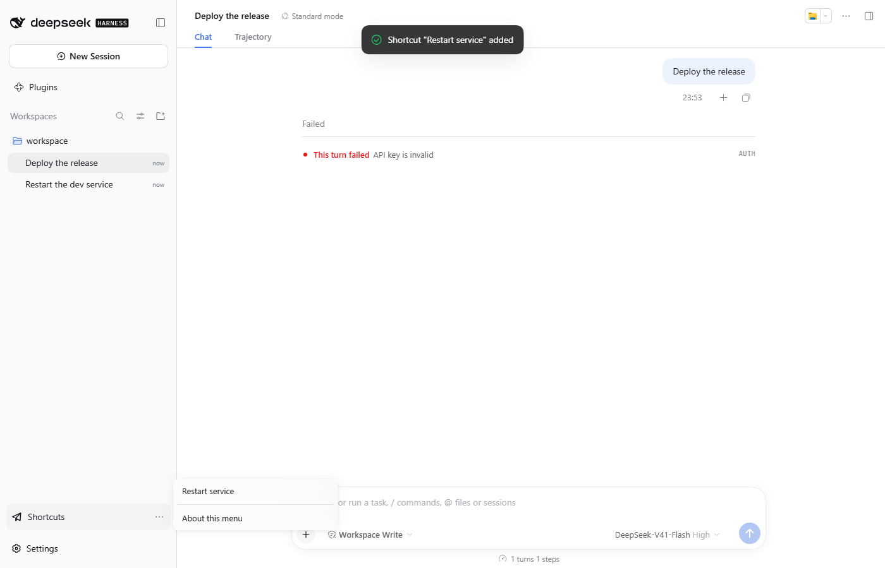
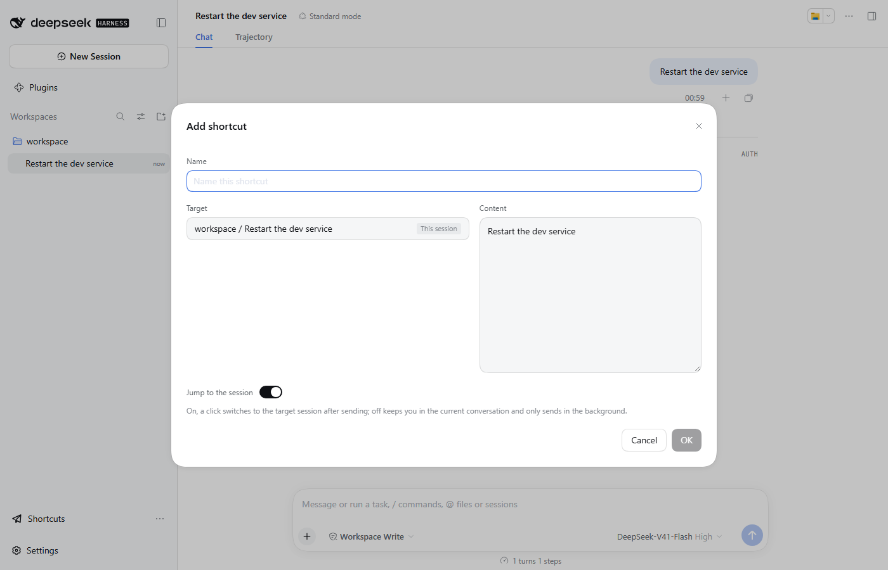

# dsh-shortcut

English | [中文](README.zh.md)

[](LICENSE)
[](package.json)
[](https://github.com/deepseek-ai/deepseek-harness)

Shortcuts for [DeepSeek Harness](https://github.com/deepseek-ai/deepseek-harness): save a message
together with its target — a session, or one agent inside it — and send it there with one click.



## Features

- A **Shortcuts** row in the sidebar-foot list above Settings. Its menu lists every saved
  shortcut; pressing one sends its text to that shortcut's target.
- After sending, the target session opens by default. A per-shortcut **Jump to the session** switch
  (in the add/edit dialog) can turn that off and keep the old background-only delivery.
- The target is picked from an inline tree: workspace → session → the session's **main agent**, a
  continuable **subagent**, or an **agent-team member**.
- Add shortcuts from any of your messages ("Add to shortcuts", left of the copy control), or manage
  them all under **Settings → Shortcuts** (add, edit, retarget, delete).
- Records live in `$DSH_HOME/shortcut/entries.json`; delivery failures are reported with a reason.



## Install

```sh
dsh plugin --profile web add dsh-shortcut
```

From a checkout, add the directory instead: `dsh plugin --profile web add /path/to/dsh-shortcut`.
Then restart `dsh web` and refresh the page.

## Usage

1. Hover one of your messages and press **Add to shortcuts**, or open **Settings → Shortcuts** and
   press **Add shortcut**.
2. Pick the target in the tree — press a session for its main agent, or expand it for a subagent or
   team member — then fill in the content and confirm.
3. Press that row in the sidebar menu: the message is sent to its target.

## Notes

- Built and tested against `@deepseek-ai/dsh` **0.2.0-rc.2**.
- A session's main agent is delivered through the host Session Controller; a subagent or team member
  through the host subagent runtime, because that is the only way to address a child session.
- "Add to shortcuts" is injected next to the copy control (the chat shell exposes no slot there), so
  a future DSH chat redesign may need `src/client/bubble-capture.ts` updated.

## Development

Setup, tests, E2E and pitfalls: [DEVELOP.md](DEVELOP.md). Publishing: [PUBLISH.md](PUBLISH.md).
Changes: [CHANGELOG.md](CHANGELOG.md).

## License

MIT — see [LICENSE](LICENSE).
