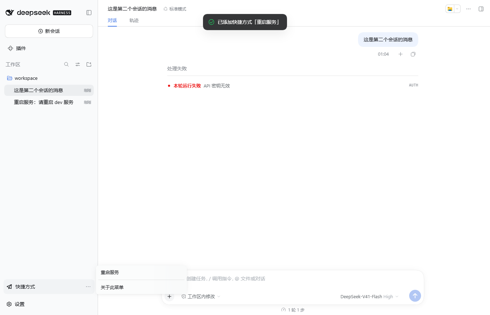
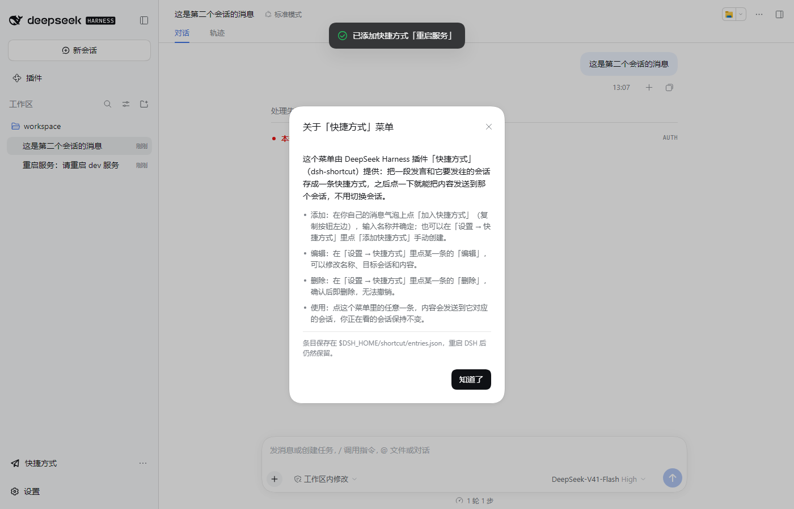
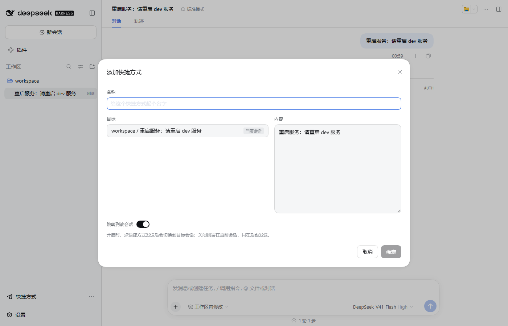
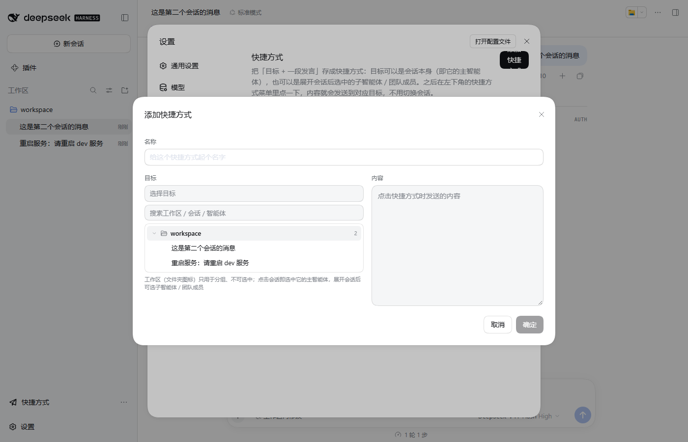
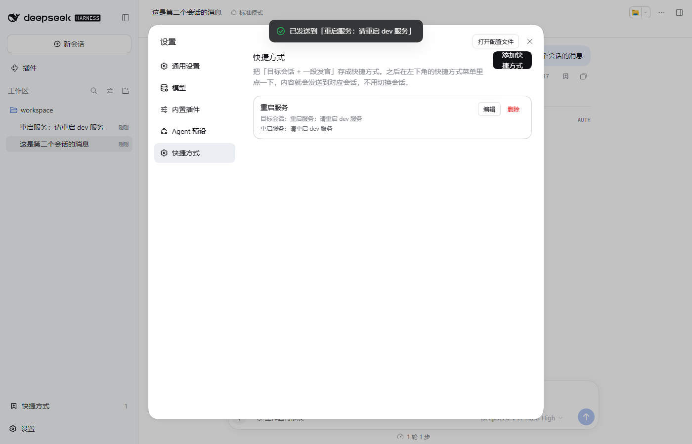
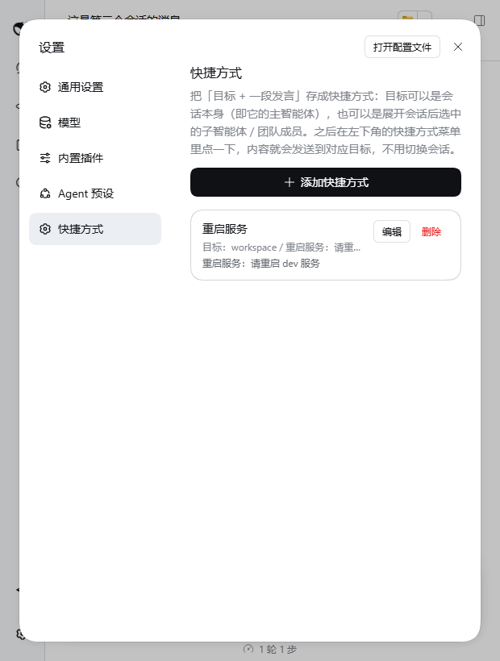

# dsh-shortcut

[English](README.md) | 中文

[](LICENSE)
[](package.json)
[](https://github.com/deepseek-ai/deepseek-harness)

一个 DeepSeek Harness（DSH）插件：把**一段发言**和**它要发往的目标**存成「快捷方式」，
之后在左下角点一下，这段内容就直接发送过去，**不用切换会话**。目标不是笼统的「某个会话」，
而是「工作区 → 会话 → 智能体」树上的一个叶子：会话自己的**主智能体**、可继续的**子智能体**，
或**团队成员**。它解决的是那种「每次都要切到另一个会话再手打一遍」的话——比如「重启服务」：
收藏一次，之后随处一键可用。

| 左下角入口（设置按钮正上方） | 消息气泡上的「加入快捷方式」 |
| --- | --- |
|  |  |

点开入口就是全部快捷方式的菜单，点其中一条即发送：



菜单最后一项是「关于此菜单」：说明这个菜单由哪个插件提供，以及如何添加、编辑和删除条目：



## 功能

- **左下角菜单，一键发送、不跳转**：侧边栏底部、其它插件入口与设置按钮之间新增一行
  「快捷方式」。点开向上弹出全部条目，点一条就把内容投递到它的目标，**当前页面停在原会话
  不动**；发送后用一条提示告诉你发到了哪个目标。
- **目标树常驻在弹窗里，不用下拉**：添加/编辑弹窗上方是一行只读的完整路径，下面直接是目标树
  （搜索框 + 可展开的工作区/会话列表）。工作区行带 DSH 原生的文件夹图标，**仅用于分组、
  不可选中**；点会话行就是选中这个会话的**主智能体**——不再有单独一行的「主智能体」。会话
  确实有子智能体或团队成员时才会出现展开箭头（没有下级就不画）：展开后列出可继续的
  **子智能体**（用委派时的「工作内容」作标签）和**团队成员**（用成员名）；子智能体自己还有
  下级时变成分支。团队成员信息来自该会话自己的投影（projection），不依赖实验性的 Team API。
- **从消息气泡收藏**：每条用户消息的复制按钮**左边**新增「加入快捷方式」按钮。弹窗打开时
  名称默认为空、内容已预填为这条气泡的原文；目标锁定为这条消息所在会话的**主智能体**
  （收藏的意义就在于此）。
- **设置页管理**：`设置 → 快捷方式` 列出全部条目，并显示目标的路径——目标是主智能体时显示
  `<工作区> / <会话>`，目标为子智能体 / 团队成员时再追加叶子；可编辑名称、目标和内容（复用
  同一个弹窗）、删除（二次确认），也可手动添加——手动添加用同一棵目标树选择目标。重新打开
  已保存的快捷方式时，会自动选中它的目标、展开所需的工作区/会话，并**滚动到选中项**。
- **严格校验、失败可读**：名称非空且未被占用、已选可投递的目标叶子、内容非空，三项齐了
  「确定」才可点；主机侧会再校验一遍。投递失败会分类并明确展示：目标会话不存在 / 已归档 /
  忙、**一次性子智能体不能接收消息**、**目标智能体所属父会话未运行**、目标不可达，或其它
  发送失败，不会静默失败。
- **持久化且不装傻**：条目保存在 `$DSH_HOME/shortcut/entries.json`（原子写入，跨重启保留）。
  文件格式为版本 2（带目标）；版本 1 的旧条目读取时按「主智能体」目标处理，并在下次保存时
  重写为版本 2。存储文件损坏时明确报错，而不是当成空列表——否则重新添加一堆条目会覆盖掉
  只是格式坏了的文件。

收藏弹窗（目标会话已锁定）：



目标选择器：展开工作区后点会话即选中它的主智能体；会话有子智能体 / 团队成员时，展开后再选：



设置页签：



窄屏下「添加快捷方式」会变成描述文字正下方的一整行：



## 安装

```sh
dsh plugin --profile web add dsh-shortcut
```

或用 npx 运行 harness 的话：

```sh
npx @deepseek-ai/dsh plugin --profile web add dsh-shortcut
```

从本地目录安装：

```sh
dsh plugin --profile web add /path/to/dsh-shortcut
```

也可以手工挂载：把依赖加进 profile 的 `package.json`，并在该 profile 的
`cordis.patch.yml` 里插入这一行：

```yaml
- insert:
    - id: shortcut
      name: dsh-shortcut
```

然后重启 `dsh web`（host 只在启动时加载插件），刷新页面即可。

## 用法

1. 任意会话里把鼠标移到自己的消息上，点「加入快捷方式」，起个名字，确定。
2. 或者在 `设置 → 快捷方式` 里点「添加快捷方式」，展开工作区后点会话即可选中它的主智能体；
   要选子智能体 / 团队成员，就先展开该会话的箭头再点叶子。
3. 在左下角点「快捷方式」，点刚才那条——内容就发送到它的目标里，你正在读的会话不变。
4. 需要改名、改目标、改内容、删除或手动新增：`设置 → 快捷方式`。

## 注意事项

- **兼容性**：按 `@deepseek-ai/dsh` **0.2.0-rc.2** 构建与实测。左下角占
  `sidebar.footer.action`，设置页占 `settings.section`；目标树的数据来自外壳自己的
  `workspaces` / `sessions` 存储（会话的子智能体投影未持久化，首次展开该会话时会调用
  `sessions.refreshProjections` 现取）。
- **两条投递路径，因为 DSH 只有两类可寻址的智能体**：
  - 会话的**主智能体**走宿主的 Session Controller（`ctx.sessionController.prompt`，
    `mode: 'queue'`），冷会话会先恢复、消息会持久化；
  - **子智能体 / 团队成员**是父会话的可继续直接子级，走宿主的 subagent 运行时
    （`ctx.subagents.prompt`，`{ mode: 'continuable', delivery: 'queue' }`）。一次性子智能体
    无法投递（`subagent/not-resumable`），子级还需要它的直接父会话处于运行状态
    （`subagent/parent-unavailable`）；这两种情况都会作为可读的错误展示，而且选择器已把
    一次性叶子置灰，从源头上避免存下不可投递的目标。
- **气泡按钮是 DOM 桥**：0.2.0-rc.2 里用户消息的操作行没有插件插槽，所以按钮通过聊天视图的
  语义锚点（`data-chat-flow-kind`、`data-clock`、`data-chat-node-key`）注入到复制按钮旁边。
  它是幂等的、React 重渲染后会自动补回、跳过乐观回显，卸载时全部移除。未来 DSH 若改动这些
  锚点，需要同步更新 `src/client/bubble-capture.ts`。
- **页脚共存**：footer action 的根节点是 `display: contents`；本插件会把它们纵向排列（与
  `dsh-diff-approval` 使用同一条规则），检测到 `dsh-footer-order` 插件时让给它管理。
- **范围**：只发往已存在的会话/智能体；不做热键、不做变量/占位符替换、不做定时发送、不跨
  设备同步。条目按 `$DSH_HOME` 全局共享，不区分 profile。

## 开发

开发环境、两半结构、测试/E2E 命令与踩过的坑见 [DEVELOP.md](DEVELOP.md)；
发布步骤见 [PUBLISH.md](PUBLISH.md)；变更记录见 [CHANGELOG.md](CHANGELOG.md)。

## 许可

MIT，见 [LICENSE](LICENSE)。
